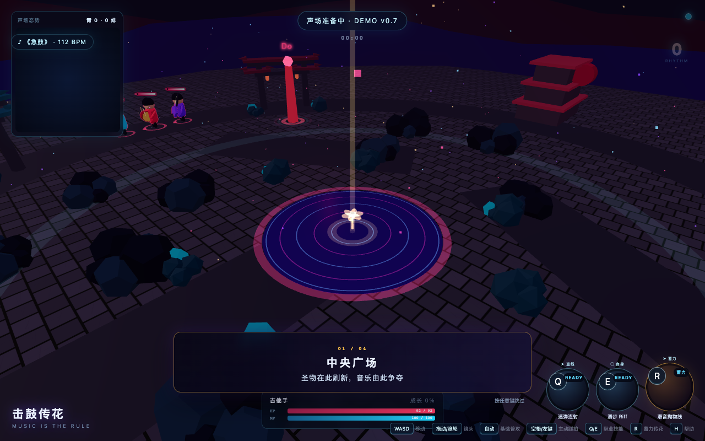

# 击鼓传花

一个把音乐节拍、团队对抗与传花结合起来的 3v3 游戏演示。玩家选择乐手，在声场中发育、抢花，并与队友完成传递。

[打开可玩演示](https://zeroplus657.github.io/jigu-chuanhua-demo/)

## 试玩

桌面浏览器可以亲自操控，手机打开后进入 AI 对局观战模式。

| 操作 | 按键 |
| --- | --- |
| 移动 | WASD |
| 踩拍 | 空格 |
| 技能 | Q / E |
| 传花 | R |

普通攻击默认自动进行。进入声场后可查看角色、阶段和节奏提示。

## 状态

当前仓库提供可玩的网页 Demo，不作为正式上线版本或微信小程序客户端。

[`visual-slice/`](https://zeroplus657.github.io/jigu-chuanhua-demo/visual-slice/) 保留早期视觉验证片；首次访问建议使用上方的主演示入口。

本地可直接打开 `index.html`，或在仓库目录运行 `python3 -m http.server 8000`。音乐与第三方素材按各自权利声明使用。
